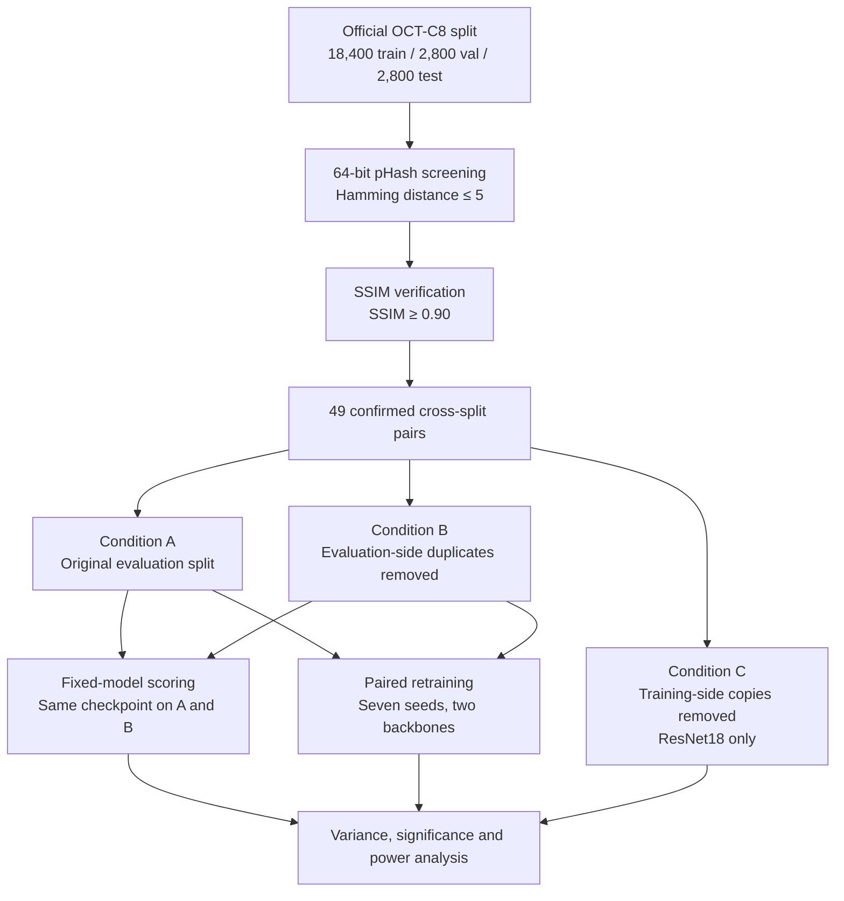

<div align="center">

# Estimating Near-Duplicate Leakage in OCT-C8

### Fixed-Model Scoring versus Paired Retraining

**Research code, experimental results, and dataset-integrity audit for the OCT-C8 retinal imaging benchmark.**

[](./Retinal_OCT_Image.ipynb)
[](https://pytorch.org/)
[](https://www.kaggle.com/datasets/obulisainaren/retinal-oct-c8)
[](#reproducibility)

[**Overview**](#overview) · [**Key Findings**](#key-findings) · [**Methodology**](#methodology) · [**Repository**](#repository-structure) · [**Getting Started**](#getting-started) · [**Citation**](#citation)

</div>

---

## Overview

**Does near-duplicate contamination meaningfully inflate the reported accuracy of a retinal OCT benchmark—and can ordinary retraining measure the effect?**

We audit the published train/validation/test partition of **OCT-C8**, a 24,000-image retinal optical coherence tomography (OCT) dataset. The audit combines **perceptual hashing (pHash)**, **structural similarity (SSIM)**, and **SHA-256 verification** to identify cross-split copies and structurally near-identical images.

We then evaluate the impact of removing confirmed evaluation-side duplicates using two complementary approaches:

1. **Fixed-model scoring:** evaluate an unchanged trained checkpoint on the original and cleaned test sets, isolating the evaluation-side difference without retraining noise.
2. **Paired retraining:** train on the original and cleaned evaluation protocols across matched random seeds, assessing the effect relative to run-to-run variation.

The experiments cover **ResNet18** and **EfficientNet-B0**. Deterministic-training and training-side-removal experiments are additionally examined on **ResNet18**.

> **Central finding:** We confirmed cross-split near-duplicates, but the fixed-checkpoint accuracy difference is approximately **0.02 percentage points (pp)**. Across seven paired retraining seeds, training variability is too large to resolve an effect this small reliably.

## Key Findings

<div align="center">

| 49 | 46 / 49 | 48 | ~0.02 pp |
|:---:|:---:|:---:|:---:|
| Confirmed cross-split pairs | Byte-identical pairs | Evaluation images removed | Fixed-model accuracy difference |

</div>

### Near-duplicate audit

| Measure | Result |
|:--|--:|
| Total OCT-C8 images | 24,000 (8 classes) |
| Original train / validation / test | 18,400 / 2,800 / 2,800 |
| pHash candidates screened | 345 |
| SSIM-confirmed, same-label cross-split pairs | **49** |
| Byte-identical confirmed pairs (SHA-256) | **46** |
| Removed evaluation images | **48** (28 validation, 20 test) |
| Cleaned validation / test | 2,772 / 2,780 |
| Removed images as a share of the dataset | **0.20%** |

| Split comparison | Candidates | Confirmed pairs | Removed images |
|:--|--:|--:|:--|
| Train–validation | 175 | 29 | 28 validation |
| Train–test | 158 | 19 | 19 test |
| Validation–test | 12 | 1 | 1 test |
| **Total** | **345** | **49** | **48** |

All confirmed pairs involving the test set were byte-identical. The three non-byte-identical confirmed pairs occurred across training and validation.

### What happens to model accuracy?

The table reports **seven-seed test accuracy (mean ± across-seed SD)**. The signed difference is **original (A) minus evaluation-cleaned (B)**, in percentage points (pp).

| Backbone | Original (A) | Cleaned (B) | A − B | Paired *p*-value |
|:--|--:|--:|--:|--:|
| **ResNet18** | 97.21 ± 0.28% | 97.42 ± 0.33% | −0.201 pp | 0.337 |
| **EfficientNet-B0** | 97.51 ± 0.26% | 97.51 ± 0.25% | −0.003 pp | 0.957 |

Neither paired retraining comparison establishes a statistically significant difference. The observed negative gaps **do not imply that leakage improved generalization**; the underlying fixed-model effects are much smaller than retraining variability.

| Fixed checkpoint, scored without retraining | Original test | Cleaned test | A − B |
|:--|--:|--:|--:|
| **ResNet18** (seed 2024) | 97.00% | 96.98% | **+0.0216 pp** |
| **EfficientNet-B0** (seed 2024) | 97.46% | 97.45% | **+0.0182 pp** |

At seven paired seeds, the estimated minimum detectable effects for retraining were **0.648 pp** (ResNet18) and **0.158 pp** (EfficientNet-B0)—far above the corresponding fixed-model differences. For a fixed model and the 20 removed test images, the maximum possible test-accuracy change is bounded by **20 / 2,800 = 0.71 pp**.

## Methodology



### Experimental conditions

| Condition | What changes? | Evaluation | Scope |
|:--|:--|:--|:--|
| **A — Original** | Published partition | Original 2,800 test images | Both backbones |
| **B — Evaluation-cleaned** | Same training list; remove 28 validation and 20 test images | Cleaned 2,780 test images | Both backbones |
| **C — Training-cleaned** | Remove 19 training copies, leaving 18,381 training images | Original 2,800 test images | ResNet18 only |

**Model configuration:** ImageNet initialization; 224 × 224 inputs; Adam optimizer; learning rate `1e-4`; batch size `32`; `10` epochs. The seven matched seeds are `7`, `17`, `42`, `55`, `99`, `123`, and `2024`.

**Determinism note:** The deterministic ResNet18 experiments use a separate training configuration and are not pooled with the ordinary seven-seed retraining comparison.

## Dataset

**OCT-C8 — Retinal OCT Image Classification**  
[Open the official Kaggle dataset](https://www.kaggle.com/datasets/obulisainaren/retinal-oct-c8)

The dataset consists of **24,000 retinal OCT B-scans**, balanced at 3,000 images per class:

`AMD` · `CNV` · `CSR` · `DME` · `DR` · `Drusen` · `MH` · `Normal`

The published per-class split is **2,300 training / 350 validation / 350 test** images. Obtain the source images from the dataset provider and preserve the original split when reproducing the audit. Dataset usage and redistribution remain subject to the provider's terms.

## Repository Structure

```text
oct-c8-near-duplicate-leakage-audit/
├── Retinal_OCT_Image.ipynb   # Research and experiment notebook
├── Output_Folder/           # Experiment outputs, audit results and supporting artifacts
├── .gitignore
└── README.md                # Project documentation
```

The experimental outputs are organized under **[`Output_Folder/`](./Output_Folder/)**, including duplicate-pair audit results, removal manifests, experimental metrics, statistical analyses, and figures. The [research notebook](./Retinal_OCT_Image.ipynb) contains the corresponding analysis and model experimentation workflow.

## Getting Started

### 1. Clone the repository

```bash
git clone https://github.com/mhtamim136/oct-c8-near-duplicate-leakage-audit.git
cd oct-c8-near-duplicate-leakage-audit
```

### 2. Obtain OCT-C8

Download the [official OCT-C8 dataset](https://www.kaggle.com/datasets/obulisainaren/retinal-oct-c8) and retain its published train/validation/test partition.

### 3. Open the notebook

Open [`Retinal_OCT_Image.ipynb`](./Retinal_OCT_Image.ipynb) in **Google Colab** or **Jupyter**. Configure the dataset and output paths for your environment, install the dependencies imported by the notebook, and follow the relevant cells in order. The experimental stack includes **Python, PyTorch/torchvision, NumPy and scikit-image**.

### 4. Explore the outputs

Use [`Output_Folder/`](./Output_Folder/) to inspect the saved experimental results, pair audits, cleaning artifacts, tables, and visualizations. To rerun experiments, follow the notebook's actual cell dependencies and preprocessing configuration rather than assuming a one-command pipeline.

> **Credentials:** Keep Kaggle API tokens and other secrets outside tracked notebooks. Use an appropriate secrets manager or environment variables; do not commit credentials to Git.

## Reproducibility

- Detection is conducted **across partitions and within the same class label**, using pHash to select candidates and SSIM to confirm matches.
- The evaluation-cleaned condition **preserves the original training list**, making fixed-checkpoint cross-evaluation a controlled comparison of the two evaluation sets.
- Fixed-model scoring uses **identical checkpoint weights** for both test sets; paired retraining instead includes run-to-run training variability.
- Repeated training comparisons use **the same seven seed values** on each condition and backbone; deterministic ResNet18 runs are reported separately.
- Results should be interpreted with the **paired variability and detectable effect size**, not only a point estimate or *p*-value.

**Scope:** This study audits one dataset and two convolutional backbones. The released data lack patient identifiers, so image-level near-duplicate screening does not establish all possible patient-level overlap; detector recall was not measured. The repository is for benchmark-integrity research, not clinical use.

## Authors

**Department of Computer Science and Engineering**  
**American International University-Bangladesh (AIUB), Dhaka, Bangladesh**

| Authors | Role |
|:--|:--|
| **Md. Murad Hasan** | Corresponding author |
| **Md. Mahafuz Anam** | Co-author |
| **Md. Al Rafiul** | Co-author |
| **Nusrat Jahan Trisna** | Supervisor |

## Citation

If this work supports your research, please cite the manuscript and the accompanying repository. The following entry describes the **2026 manuscript**, without claiming publication or a DOI:

```bibtex
@misc{hasan2026octc8leakage,
  title  = {Estimating Near-Duplicate Leakage in OCT-C8: Fixed-Model Scoring versus Paired Retraining},
  author = {Hasan, Md. Murad and Anam, Md. Mahafuz and Rafiul, Md. Al and Trisna, Nusrat Jahan},
  year   = {2026},
  note   = {Research manuscript and accompanying experimental artifacts},
  url    = {https://github.com/mhtamim136/oct-c8-near-duplicate-leakage-audit}
}
```

Publication details may be added after a venue and DOI are formally confirmed.

---

<div align="center">

### Murad Hasan Tamim

*Computer Science & Engineering Student | Data Science & Machine Learning Researcher*

<a href="https://mhtamim136.github.io/">
  
</a>
<a href="https://github.com/mhtamim136/oct-c8-near-duplicate-leakage-audit">
  
</a>
<a href="https://github.com/mhtamim136">
  
</a>

<br />

> Interested in collaborating on **dataset integrity, trustworthy machine learning, or medical imaging research**? Feel free to connect through the [portfolio](https://mhtamim136.github.io/) or [GitHub profile](https://github.com/mhtamim136).

---

**⭐ If you find this research or its experimental artifacts useful, consider starring the repository! ⭐**

</div>
